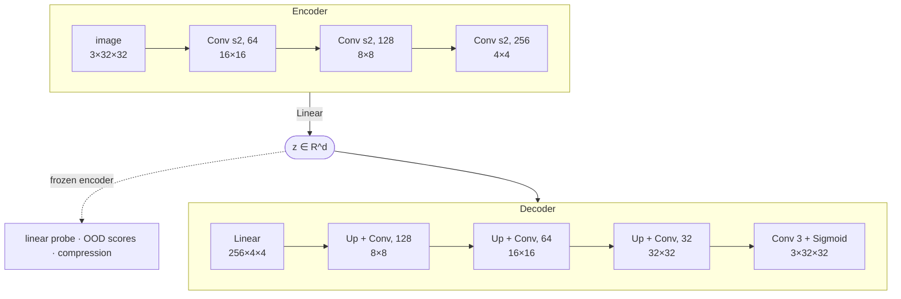
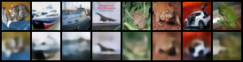
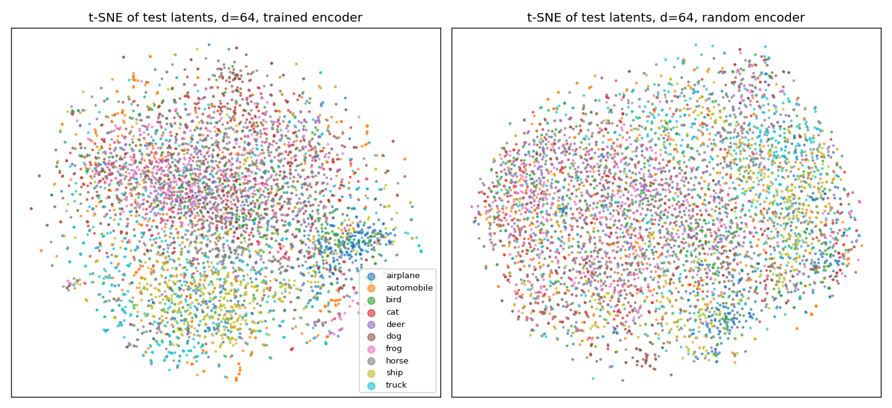
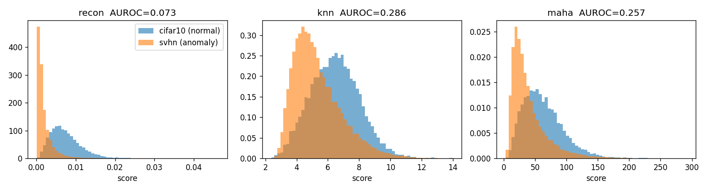
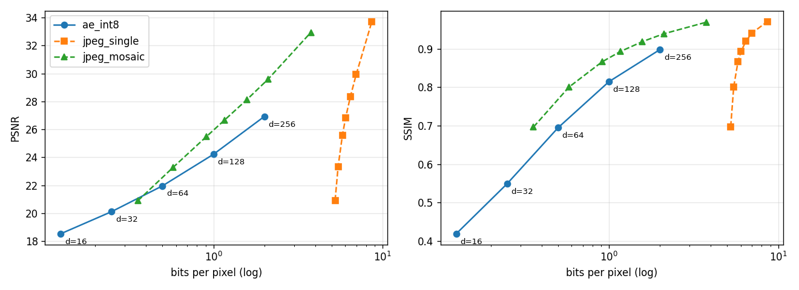

# conv-ae-latent

A convolutional autoencoder in PyTorch, trained on CIFAR-10, whose frozen encoder is reused for three tasks: **linear-probe classification**, **out-of-distribution detection**, and **image compression** compared with JPEG.

This is a personal follow-up to my work on autoencoders for anomaly detection on network data (HAIDS-PoA). Here I move to images and ask a simple question: *what does a latent space learned only by reconstruction actually contain, and what is it good for?*

All numbers below are produced by the scripts in this repository (seed 0, CIFAR-10 test set unless stated otherwise).

## Architecture



Each convolution is followed by BatchNorm and ReLU, except the output layer.
Each convolution is followed by BatchNorm and ReLU, except the output layer.
- **Encoder**: three stride-2 convolutions (learned downsampling), then a linear layer to a flat latent vector `z` of size `d` (16 to 256). A vector, not a feature map, so that a linear probe, a distance, or a fixed-size code can be applied directly.
- **Decoder**: nearest-neighbor upsampling + convolution instead of transposed convolutions, to avoid checkerboard artifacts; sigmoid output in [0, 1].
- **Loss**: pixel MSE (PSNR is a direct function of MSE). Adam, lr 1e-3, batch 128, 30 epochs; the checkpoint with the best validation MSE is kept (10% of the training set held out for validation; the test set is used only for final numbers).
- 1,288,771 parameters for d = 64.

## Results

### 1. Reconstruction vs latent size

| d | test MSE | PSNR (mean per image) | PSNR (of mean MSE) |
|---|---|---|---|
| 16 | 0.01620 | 18.52 dB | 17.91 dB |
| 32 | 0.01128 | 20.11 dB | 19.48 dB |
| 64 | 0.00738 | 21.96 dB | 21.32 dB |
| 128 | 0.00442 | 24.21 dB | 23.54 dB |
| 256 | 0.00238 | 26.93 dB | 26.24 dB |

Both PSNR conventions are reported: averaging per-image PSNR gives a higher value than the PSNR of the average MSE (Jensen's inequality). For d = 64, final train and validation MSE are close (0.00715 vs 0.00745), so the bottleneck, not overfitting, limits quality; each doubling of `d` still adds 1.6 to 2.7 dB.


*Top: test images. Bottom: reconstructions (d = 64).*

### 2. Linear probe (d = 64, logistic regression on frozen features)

| representation | dim | test accuracy |
|---|---|---|
| trained encoder | 64 | 38.79% |
| PCA of pixels | 64 | 38.95% |
| random encoder (same architecture) | 64 | 35.11% |
| raw pixels | 3072 | not measured |

Protocol: features standardized with train statistics, regularization `C` chosen on validation, accuracy reported once on test.

**Reading**: training improves on a random encoder (+3.7 points), but the latent is no more linearly informative about the class than a PCA of the same size: the difference (0.16 points) is well below the standard error of a 10,000-image accuracy (about 0.5 points). An MSE objective keeps what is expensive to reconstruct (global color, low frequencies), which is also what PCA keeps, not what separates classes.


*t-SNE of 5,000 test latents (qualitative only: t-SNE does not preserve global distances). With the trained encoder, airplanes form a visible group and ships and trucks share a region, consistent with a latent driven by background and global color; the random encoder is more mixed.*

### 3. Out-of-distribution detection (d = 64)

Normal: CIFAR-10 test (10,000). Anomalies: SVHN test (26,032), never seen during training. Higher score = more anomalous.

| score | AUROC | FPR at 95% TPR |
|---|---|---|
| reconstruction error | 0.073 | 1.000 |
| kNN distance in latent (k = 5) | 0.286 | 0.985 |
| Mahalanobis distance in latent | 0.257 | 0.994 |
| kNN, random encoder | 0.203 | 0.996 |
| Mahalanobis, random encoder | 0.177 | 0.999 |

**Every score is below chance.** SVHN images are reconstructed *better* than CIFAR-10 test images (mean MSE 0.00197 vs 0.00739) and fall in the dense region of the training latent cloud. SVHN digits are simpler images (flat backgrounds, little texture); reconstruction difficulty tracks input complexity more than membership in the training distribution. The same failure was reported for likelihood-based generative models on this pair (Nalisnick et al., ICLR 2019).

Flipping the score sign would give an AUROC of 0.927, but choosing the direction after looking at the anomalies is tuning on the test set; an anomaly more complex than CIFAR-10 would then be missed. The takeaway for anomaly detection in general: a low reconstruction error does not mean "normal".



### 4. Compression vs JPEG

The latent is quantized to 8 bits per dimension (per-dimension min/max learned on train), so an image costs `d` bytes, i.e. `8d / 1024` bits per pixel (bpp). Decoder outputs are rounded to 8 bits per channel like a real image file. JPEG (Pillow, default 4:2:0) is measured two ways:
- **per image**: each 32×32 image is its own file, header included;
- **mosaic**: the 10,000 test images are tiled and encoded once, so the header cost is amortized. This is the fair comparison.

| codec | setting | bpp | PSNR (dB) | SSIM |
|---|---|---|---|---|
| AE int8 | d = 16 | 0.125 | 18.52 | 0.418 |
| AE int8 | d = 32 | 0.250 | 20.10 | 0.549 |
| AE int8 | d = 64 | 0.500 | 21.95 | 0.695 |
| AE int8 | d = 128 | 1.000 | 24.21 | 0.815 |
| AE int8 | d = 256 | 2.000 | 26.92 | 0.898 |
| JPEG mosaic | q = 5 | 0.358 | 20.89 | 0.696 |
| JPEG mosaic | q = 10 | 0.580 | 23.29 | 0.800 |
| JPEG mosaic | q = 20 | 0.909 | 25.48 | 0.866 |
| JPEG mosaic | q = 30 | 1.166 | 26.67 | 0.893 |
| JPEG mosaic | q = 50 | 1.574 | 28.11 | 0.919 |
| JPEG mosaic | q = 70 | 2.107 | 29.59 | 0.939 |
| JPEG mosaic | q = 90 | 3.770 | 32.94 | 0.969 |
| JPEG per image | q = 5 | 5.242 | 20.91 | 0.697 |
| JPEG per image | q = 90 | 8.648 | 33.72 | 0.971 |

(All per-image JPEG rows are in `runs/compression/compression.json`; the figure shows the full curves.)

**Reading**:
- 8-bit quantization costs at most 0.01 dB of PSNR versus a float32 latent, for 4× fewer bits.
- Against amortized JPEG, the autoencoder loses wherever both have a point: JPEG q = 20 beats d = 128 (25.48 vs 24.21 dB, 0.866 vs 0.815 SSIM, with fewer bits), and q = 50 beats d = 256 (28.11 vs 26.92 dB with fewer bits).
- d = 16 and d = 32 reach rates below JPEG's lowest setting (0.358 bpp at q = 5), so there is no JPEG point at the same rate.
- Against per-image JPEG files, the AE looks far better, but only because a 32×32 JPEG file is mostly header (about 670 bytes at q = 5 versus about 46 bytes of data per image in the mosaic).
- Not counted in the AE rate: the decoder itself (about 1.3 M parameters) and its specialization to CIFAR-10; the latent is also not entropy-coded, unlike learned codecs such as Ballé et al. (2018).
- The mosaic PSNR is slightly lower than per-image PSNR at high quality (32.94 vs 33.72 dB at q = 90): the decoder's chroma upsampling interpolates across tile borders. With 4:4:4 sampling the two are pixel-identical. This effect disadvantages JPEG, not the AE.



## Reproduce

Tested on WSL Ubuntu 22.04, Python 3.10, PyTorch 2.14 (CUDA), laptop GPU (RTX 2050): 12 to 53 s per epoch for d = 64.

```bash
python -m venv .venv && source .venv/bin/activate
pip install torch torchvision        # pick the build for your CUDA/CPU at pytorch.org
pip install -r requirements.txt && pip install -e .
pytest

# 1. train (d = 64), then the other latent sizes
python -m convae.train --config configs/cifar10_d64.yaml
python -m convae.evaluate --run runs/cifar10_d64
./scripts/train_latent_sweep.sh 16 32 128 256

# 2-4. frozen-encoder tasks
python -m convae.probe --run runs/cifar10_d64 --skip_pixels
python -m convae.tsne --run runs/cifar10_d64
python -m convae.anomaly --run runs/cifar10_d64 --ood svhn
python -m convae.compression --runs runs/cifar10_d16 runs/cifar10_d32 runs/cifar10_d64 runs/cifar10_d128 runs/cifar10_d256

# copy the figures used in this README
./scripts/collect_figures.sh
```

Every run writes its config, metrics and outputs to `runs/<run_name>/` (not versioned). Overrides: `--set model.latent_dim=128 run_name=my_run`.

## Layout

```
configs/            training config (YAML)
src/convae/
  model.py          encoder / decoder
  data.py           CIFAR-10, STL-10, SVHN loaders, seeded validation split
  train.py          training loop, CSV metrics, best checkpoint
  evaluate.py       test-set reconstruction metrics and sample grid
  features.py       frozen-encoder latent extraction
  probe.py          linear probe and baselines
  tsne.py           2-D latent visualization
  anomaly.py        OOD scores, AUROC, FPR@95TPR
  compression.py    rate-distortion vs JPEG
tests/              unit tests (shapes, seeding, overfit sanity check, metrics, quantization)
```

## Limitations and next steps

- One seed per configuration; differences smaller than about 0.5 points of accuracy or a few hundredths of AUROC should not be over-read.
- Next: ONNX export and C++ inference with ONNX Runtime, int8 quantization, CPU latency and memory measurements.

## License

MIT
